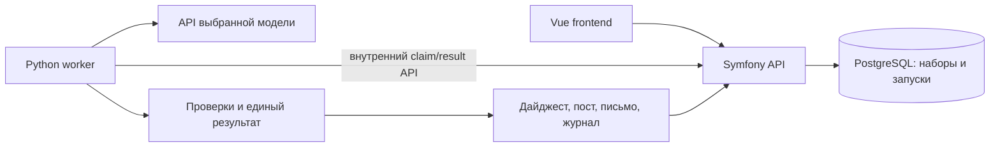

# Модели и архитектура для notFive

Срез официальной документации на 7 ноября 2026 года. Требования и источник: [CONTEXT.md](CONTEXT.md). Ключей и учебного набора ещё нет: ниже сравнение возможностей и инженерная рекомендация, а не измеренный рейтинг качества.

## Рекомендация

Первый сквозной прототип: **YandexGPT Pro 5.1 через Yandex AI Studio**, обёртка и проверки на **Python**, существующий Symfony оставить публичным backend. После получения ключей сравнить с Alice AI LLM и Claude Sonnet 5.5 на одинаковых материалах. Если команда уверенно работает только с PHP, допустимо написать весь конвейер в Symfony: Python не является требованием API или кейса.

Причина выбора стартовой модели: в официальном примере структурированного ответа явно используется `yandexgpt-5.1`. Это уменьшает неопределённость первой интеграции. Большой контекст и более низкая цена других моделей делают их кандидатами для проверки, но не доказывают качество группировки и сохранения оговорок. [Пример JSON Schema](https://aistudio.yandex.ru/ru/docs/ai-studio/operations/generation/completions-structured).

## Кандидаты с публичным API

| Модель и провайдер | Контекст | Для чего рассматриваем | Условие выбора |
| --- | --- | --- | --- |
| YandexGPT Pro 5.1, Яндекс | 32 768 | Первая интеграция, извлечение и генерация | Документирован JSON Schema; дробить вход с запасом под ответ |
| Alice AI LLM, Яндекс | 131 072 | Альтернатива для более крупных входов | Проверить schema-режим на выбранном API и наш набор |
| DeepSeek V4.1 Flash, Яндекс | 1 048 576 | Более дешёвый вариант в том же облаке | Проверить поддержанные параметры, схему и качество |
| Qwen3.6 35B, Яндекс | 262 144 | Ещё один экономичный кандидат | Рассматривать после базового прогона |
| Claude Sonnet 5.5, Anthropic | 1M | Независимый кандидат для проверки фактов, конфликтов и русского текста | Нужен доступный команде аккаунт API с оплатой |
| DeepSeek Flash, прямой API | 1M | Недорогая альтернатива отдельного провайдера | JSON mode не заменяет проверку схемы |
| GigaChat | Зависит от модели | Российская альтернатива со структурированным выводом | Проверить актуальное подключение через Cloud.ru |

URI Яндекса: `gpt://<folder_id>/yandexgpt-5.1`, `.../aliceai-llm`, `.../deepseek-v4.1-flash`, `.../qwen3.6-35b-a3b`. На момент исследования YandexGPT Lite 5 и DeepSeek V4 Flash отмечены для отключения 15 ноября 2026 года: новый проект на них не основывать. [Каталог моделей](https://aistudio.yandex.ru/ru/docs/ai-studio/concepts/generation/models).

### Яндекс

Официальный совместимый с OpenAI клиентом адрес: `https://ai.api.cloud.yandex.net/v1`; нужны API-ключ и folder ID. Начать с аккаунта, облака/каталога и подключённого биллинга, затем проверить небольшой реальный запрос. Условия пробного гранта проверяются в аккаунте, фиксированной бесплатной суммы здесь не предполагаем. API-примеры по потреблению оплачиваются отдельно; квоты подписки требуют специального подключения для поддержанных сценариев. [Начало работы](https://aistudio.yandex.ru/ru/docs/ai-studio/quickstart/), [ключ](https://aistudio.yandex.ru/ru/docs/ai-studio/operations/get-api-key), [структурированный запрос](https://aistudio.yandex.ru/ru/docs/ai-studio/operations/generation/completions-structured).

У Яндекса структурированный ответ доступен не для всех моделей и не совмещается с вызовом инструментов в одном запросе. Для нашего конвейера инструменты внутри модельного запроса не нужны. Возможности конкретного endpoint проверять отдельно, не переносить параметры автоматически между native и OpenAI-совместимым API. [Ограничения структурированного вывода](https://aistudio.yandex.ru/ru/docs/ai-studio/concepts/generation/structured-output).

### Claude

Текущий ID: `claude-sonnet-5-5`. Это подходящий кандидат для сравнения, но утверждать превосходство без тестов нельзя. Sonnet 5.5 не принимает `temperature`, `top_p`, `top_k`: они вызывают HTTP 400. Адаптер должен учитывать возможности модели, а не выставлять всем `temperature=0`. [Карточка модели](https://platform.claude.com/docs/en/models/sonnet-5-5/overview).

Структурированный формат задаётся через `output_config.format`. Встроенный механизм Citations несовместим со строгим JSON-выводом, поэтому в нашей схеме нужны собственные `source_id`, `claim_id` и цитируемый фрагмент для проверки. Валидный JSON гарантирует форму, не достоверность. [Structured outputs](https://platform.claude.com/docs/en/build-with-claude/structured-outputs).

Понадобятся Console, ключ и подтверждённая возможность пользоваться API/оплачивать его из региона команды. Публичный API не означает доступ без аккаунта. Не планировать защиту на Claude, пока реальный запрос с сервера не прошёл. На странице supported regions при исследовании была версия с датой вступления 12 ноября 2026 года, позже текущей даты; она не подтверждает условия на 7 ноября. [Получение доступа](https://support.claude.com/en/articles/8114521-how-can-i-access-the-claude-api), [поддерживаемые регионы](https://www.anthropic.com/legal/supported-regions).

### Другие варианты

Прямой DeepSeek API использует `deepseek-flash`, сейчас соответствующий DeepSeek-V4.1-Flash-1017. Это изменяемый псевдоним: сохранять фактическую версию ответа, не обещать неизменность при повторе через месяц. JSON mode обеспечивает JSON, но не строгую бизнес-схему; документация также предупреждает о возможном пустом содержимом ответа. Нужны локальная валидация и ограниченные повторы. [Модели и тарифы](https://api-docs.deepseek.com/quick_start/pricing/), [JSON mode](https://api-docs.deepseek.com/guides/json_mode/).

GigaChat документирует JSON Schema; с 1 сентября 2026 года подключение новых платных клиентов направляется в Cloud.ru. Это запасной вариант после проверки регистрации, квот и оплаты. Бесплатный лимит в этом исследовании не подтверждён. Не копировать примеры с отключённой проверкой TLS: настроить доверенные сертификаты. [Структурированный вывод](https://developers.sber.ru/docs/ru/gigachat/guides/structured-output), [подключение](https://developers.sber.ru/docs/ru/gigachat/individuals-quickstart).

У OpenAI также есть публичные модели со структурированным выводом: GPT-6.1 Sol и более дешёвая GPT-6 Luna. Это дополнительная опция при уже доступном аккаунте и оплате, без причины подключать ещё одного провайдера в первый день. [Sol](https://developers.openai.com/api/docs/models/gpt-6.1-sol), [Luna](https://developers.openai.com/api/docs/models/gpt-6-luna), [тарифы](https://developers.openai.com/api/docs/pricing).

## Стоимость условного прогона

Для сравнения предполагаем суммарно **100 000 входных + 10 000 выходных токенов за весь конвейер**, включая все обращения. Это пример арифметики, не прогноз размера набора. Без скидок кеша, инструментов и batch; дополнительные повторы и оплачиваемые reasoning-токены увеличат расход.

| Провайдер / модель | Вход / выход | Цена условного прогона |
| --- | --- | ---: |
| Яндекс / YandexGPT Pro 5.1 | 0,8 / 0,8 ₽ за 1000 | 88 ₽ |
| Яндекс / Alice AI LLM | 0,5 / 1,2 ₽ за 1000 | 62 ₽ |
| Яндекс / Alice AI LLM Flash | 0,1 / 0,2 ₽ за 1000 | 12 ₽ |
| Яндекс / DeepSeek V4.1 Flash | 0,3 / 0,5 ₽ за 1000 | 35 ₽ |
| Яндекс / Qwen3.6 35B | 0,2 / 0,3 ₽ за 1000 | 23 ₽ |
| Anthropic / Sonnet 5.5 | $2 / $10 за миллион | $0,30 |
| DeepSeek / Flash, peak | $0,30 / $1,20 за миллион | $0,042 |
| OpenAI / GPT-6.1 Sol | $2 / $10 за миллион | $0,30 |
| OpenAI / GPT-6 Luna | $0,10 / $0,50 за миллион | $0,015 |

Источники: [Яндекс, синхронные цены в рублях с НДС](https://aistudio.yandex.ru/ru/docs/ai-studio/pricing), [Anthropic](https://platform.claude.com/docs/en/about-claude/pricing), [DeepSeek](https://api-docs.deepseek.com/quick_start/pricing/), [OpenAI](https://developers.openai.com/api/docs/pricing). Для OpenAI пример попадает в стандартный диапазон до 272K входных токенов запроса. Валюты не пересчитывались. Разные токенизаторы и число попыток изменят фактическое сравнение. Стоимость показывать по usage и версии тарифа; отсутствие usage обозначать `null`, не нулём.

Ограничить число вызовов, входные токены, продолжительность и общий расход прогона. Бюджет команды пока не задан. Никаких платных обращений в ходе этого исследования не выполнялось.

## На чём писать обёртку

| Вариант | Оценка для этой команды и срока |
| --- | --- |
| Python | Рекомендую для AI-модуля: удобно менять схемы, обработку текста и проверки; Pydantic для строгих моделей, pytest для кейсов, HTTP-клиент или SDK провайдера |
| Go | Разумный выбор при хорошем опыте команды; удобный деплой одним бинарником. Выигрыш общей задержки не очевиден, пока большая часть времени уходит на внешний API |
| Rust | Имеет смысл при готовой экспертизе и заготовках; освоение ownership и экосистемы ради HTTP-обёртки не даёт преимуществ по критериям кейса |
| PHP/Symfony | Самый короткий путь без второго языка. Тот же конвейер можно собрать HTTP-клиентом, DTO, валидаторами и консольной командой |

Это инженерная оценка, не бенчмарк языков. Публичный API не требует GPU на VPS. Fine-tuning, векторная БД, RAG по всей сети, агентный фреймворк и несколько моделей одновременно не нужны для первого результата.

## Предлагаемая архитектура

Сначала реализовать запускаемый из CLI Python-конвейер на файлах. Затем тот же модуль подключить к worker; Symfony принимает файлы, хранит состояния и выдаёт результаты. Worker забирает задания через закрытый API с сервисной аутентификацией; его интерфейс не публикуется в интернет. База доступна внутри Compose. Nginx завершает TLS и проксирует Symfony, приложение и worker выпускаются согласованными версиями образов.

Для UI нужны долгоживущие задания: атомарное получение, lease, предел попыток, восстановление после рестарта, идемпотентная запись результата. Транспортную повторную отправку не путать с новым платным запросом. На первом этапе один worker и очередь заданий в уже существующей PostgreSQL; отдельный Redis/Kafka не требуется. Не считать фоновые задачи процесса HTTP надёжной очередью. [Ограничения FastAPI BackgroundTasks](https://fastapi.tiangolo.com/tutorial/background-tasks/).

## Конвейер обработки

1. **Нормализация кодом.** Проверить структуру входа, уникальность ID, дату и часовой пояс, текст и лимиты. Сохранить оригинал, хеш и реестр источников. Исключить неподтверждённую дату и материалы вне периода, записав причины. Не обрезать статью молча: разбивать с привязкой фрагментов к оригиналу.
2. **Извлечение моделью.** Определить тему и отдельные события; извлечь атомарные утверждения, числа, организации, даты, последствия, автора заявления, оговорки, ссылки на исходные фрагменты. Поля неизвестных сведений оставлять пустыми с объяснением.
3. **Группировка моделью.** Сопоставить событие, объект и время. Детерминированные признаки помогают найти кандидатов, но один CVE или компания не означают одно событие. Перепечатки сохраняются как источники, а не независимые подтверждения. Одна статья может иметь несколько event ID.
4. **Ранжирование моделью.** Сравнить последствия, масштаб, срочность и пользу аудитории с опорой на claim ID. Не выводить масштаб из количества статей. Для равных кандидатов предусмотреть стабильное правило порядка. Отобрать максимум пять.
5. **Единый результат.** Сформировать события, доказательства, объяснения и короткие версии для поста в одном структурированном объекте. Конфликты хранить явно. Дайджест, пост и письмо строить из одного результата.
6. **Проверки кодом.** JSON Schema, валидность ID, наличие фрагмента в статье, даты, числа, допустимые ссылки, поля, количество событий, длина, отсутствие длинного тире. URL и название источника брать из реестра, а не доверять сгенерированным строкам.
7. **Проверка смысла.** Наличие цитаты не доказывает, что она подтверждает утверждение. На учебном наборе нужна ручная разметка; дополнительно можно применить отдельный вызов критика и измерить его эффект. Возвращать короткое объяснение ошибки, а не требовать скрытую цепочку рассуждений.
8. **Ограниченное исправление.** Передать модели только конкретные ошибки, например до двух попыток. Неподтверждённое утверждение удалить; если событие после этого невозможно пересказать, исключить с причиной. Нельзя показывать аварийный отказ API как «новостей не найдено».
9. **Экспорт кодом.** Стабильные шаблоны, CSV с экранированием, все исходные строки в журнале. Проверить совпадение событий и ссылок в форматах и официальный `check_digest.py`. Не исправлять готовый контрольный результат руками.

Граница доверия: текст статьи не попадает в системные инструкции и не управляет инструментами. Модель не получает секретов, доступа к почте или возможности выполнять команды. Если добавим живой сбор: согласованный список источников, лимиты времени/размера и защита от запросов во внутреннюю сеть. HTML и Markdown отображаются безопасно, никакого исполнения кода из новости.

## Воспроизводимость и сравнение

Хранить для каждого запуска: T и период, хеш набора, commit приложения, версии зависимостей, provider и запрошенный/возвращённый model ID, точные промпты и их версию, применённые настройки, время, промежуточный JSON, ответы без секретов, журнал, ошибки, число вызовов, usage и оценку стоимости с валютой. Не обещать побайтовое совпадение генерации; проверять устойчивость фактов и правил.

Профиль провайдера должен перечислять возможности: JSON mode/schema, ограничения схемы, параметры генерации, контекст, usage. Общий интерфейс возвращает данные, версию, usage, request ID и тип ошибки. Никакого скрытого переключения модели при сбое контрольного прогона: профиль фиксируется заранее, изменения явно видны в истории.

После получения учебных материалов разметить ожидаемые события и доказательства. Если набора достаточно, отделить примеры настройки от проверки. Выполнить восемь обязательных сценариев, затем проверки границ времени, неизвестной даты/таймзоны, рекламного текста, зависимых перепечаток, нескольких событий статьи, длинных входов, неверного JSON, 429/timeout и переполнения лимитов текста. На одних данных повторить запуск каждого кандидата три раза. Это план, а не уже выполненные тесты.

Выбирать сначала по фактическим ошибкам и обязательным проверкам, потом по качеству обоснования, затем по задержке и цене. Измерять реальное время всего конвейера, а не одного запроса. Дополнительного критика оставить только при измеримом улучшении.

## Порядок реализации на хакатоне

1. Получить архив и ключ Яндекса, выполнить минимальный запрос со схемой; проверить доступ с VPS.
2. Сделать CLI-конвейер и все четыре экспорта на учебном наборе. Зафиксировать восемь тестов.
3. Подключить существующие Symfony/PostgreSQL и интерфейс загрузки/результатов. Уточнить контракт по архиву.
4. Сравнить базовую модель с Alice AI и, если доступен, Claude. Не тратить время на все варианты одновременно.
5. До контрольного прогона зафиксировать код, промпты и модель, проверить чистый запуск по README. Только после обязательных проверок заниматься живым сбором и другими дополнительными возможностями.
