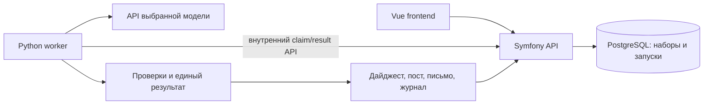

# Модели и архитектура для notFive

Срез официальной документации на 7 ноября 2026 года. Требования и источник: [CONTEXT.md](CONTEXT.md). На момент первоначального исследования ключей и учебного набора ещё не было: ниже сравнение возможностей и инженерная рекомендация, а не измеренный рейтинг качества. Дополнения от 8 ноября фиксируют последующую реализацию.

**Текущая интеграция после объединения веток:** Symfony вызывает сбор Go через закрытый GraphQL `POST /graphql` (`collect`, режимы `DATASET`/`SITES`/`DEFAULT`) и сохраняет материалы. Анализ Alice, экспорт и две REST-ручки полного цикла реализованы в Go отдельно; текущий `GoRunDispatcher` ещё не вызывает их и не передаёт их файлы в публикацию или рассылку. Контракты: [GraphQL](../../services/digest/graph/schema.graphqls), [REST и примеры](../../services/digest/README.md).

## Дополнение 8 ноября: GenSearch и точное окно новостей

Это обновление первоначального исследования: Go 1.26 уже выбран и реализован, ключ Responses API пользователь настроил. Пользователь предложил отдельный Yandex Search API с генеративным ответом. Ниже проверка документации, не результат платного прогона GenSearch. Подключение нового поискового API пока не выполнено.

**Рекомендация после обсуждения с пользователем:** для текущего прототипа оставить `web_search → загрузка статей → проверка дат кодом → генерация дайджеста`. GenSearch не требуется для отсеивания дат. Его преимущество — предварительное сужение поисковой выдачи, которое может повысить долю свежих кандидатов; это надо измерить на одном периоде, а не предполагать. Рассматривать переход, только если текущий поиск плохо находит свежие публикации. Офлайн-набор организаторов не отправлять в веб-поиск. Symfony-админку пользователь отменил 8 ноября; её реализация удалена.

В инструменте `web_search` Responses API документированы `allowed_domains`, регион и размер поискового контекста. Отдельного параметра диапазона дат нет. У отдельного `POST https://searchapi.api.cloud.yandex.net/v2/gen/search` есть `searchFilters`, включая `date`, а также `sources` и `searchQueries` в ответе. Это позволяет задавать фильтр в коде и сохранять конкретные найденные URL. В его схеме нет выбора `model`, `temperature`, `max_output_tokens` или пользовательской JSON Schema; это готовый сервис генеративного поиска, не полная замена нашему вызову модели. [Web Search](https://aistudio.yandex.ru/ru/docs/ai-studio/concepts/agents/tools/websearch), [REST GenSearch](https://aistudio.yandex.ru/ru/docs/search-api/api-ref/GenSearch/search).

Пример тела запроса, а не готовый финальный дайджест:

```json
{
  "folderId": "<YANDEX_FOLDER_ID>",
  "messages": [{
    "role": "ROLE_USER",
    "content": "Найди публикации о новых событиях информационной безопасности за период после 7 ноября 2026 13:01:59 и до 8 ноября 2026 13:01:59 по Москве включительно. Укажи первоисточники и ссылки на статьи. Не подменяй новости годовыми прогнозами и ретроспективами без новых фактов."
  }],
  "site": {"site": [
    "securitylab.ru",
    "xakep.ru",
    "https://habr.com/ru/"
  ]},
  "searchFilters": [
    {"date": "20261107..20261108"},
    {"lang": "ru"}
  ],
  "enableNrfmDocs": true,
  "getPartialResults": false
}
```

`date` принимает значение оператора без префикса `date:`. Диапазон включает обе календарные даты; точность часов/минут/часового пояса не документирована. Справка поиска называет это датой добавления страницы, инструкция API — датой обновления документа. Поэтому нельзя считать результат доказательством исходного `published_at`. Для одного дня применяется `20261108`, для нашего пересекающего полночь окна — `20261107..20261108`. [Синтаксис оператора](https://yandex.ru/support/search/ru/query-language/search-operators), [инструкция API](https://aistudio.yandex.ru/ru/docs/search-api/operations/generative-search).

Предлагаемый путь: вычислить `(T−24h,T]` по Москве → получить кандидатов с фильтром календарных дат → открыть страницы → извлечь исходную дату с часовым поясом → исключить неизвестные даты и всё вне окна → передать только допустимые материалы модели для группировки и четырёх выходных файлов. `dateModified`, дата поискового результата и год, упомянутый в тексте, не заменяют дату публикации. Свежая публикация о старом событии допустима только при существенных новых фактах. Поисковый индекс не гарантирует полноту всех публикаций за сутки; пустой результат означает отсутствие найденных и проверенных материалов, не отсутствие новостей вообще.

`site` допускает до пяти сайтов, поддомены и пути к разделам; `host` — до пяти хостов без поддоменов и путей; `url` — до десяти конкретных страниц. Эти поля взаимоисключающие. Для источников из Приложения 1 полезен `site`, но раздел Хабра `/ru/hubs/infosecurity/` не охватывает URL статей `/ru/articles/` и `/ru/companies/...`: нужен более широкий путь с тематическим отбором. Это инженерный вывод по структуре адресов. `enableNrfmDocs: true` разрешает документы, недоступные прямым переходом с главной страницы, при выборе `site`. [Области поиска](https://aistudio.yandex.ru/ru/docs/search-api/concepts/generative-response), [параметры](https://aistudio.yandex.ru/ru/docs/search-api/operations/generative-search).

Для доступа нужны роль `search-api.webSearch.user` и API-ключ с областью `yc.search-api.execute`; заголовок `Authorization: Api-Key ...`. Работающий ключ модели не следует автоматически считать проверенным доступом к отдельному endpoint. [Подключение](https://aistudio.yandex.ru/ru/docs/search-api/operations/generative-search).

По опубликованному тарифу на дату проверки GenSearch стоит 5080 ₽ за 1000 запросов с НДС, то есть 5,08 ₽ за запрос. Один запрос в сутки — 152,40 ₽ за 30 дней; пять запросов в сутки — 762 ₽. Последующая генерация нашим LLM оплачивается отдельно. Обычный синхронный текстовый поиск днём стоит 488 ₽ за 1000 запросов: если от GenSearch нужны только ссылки, после прототипа имеет смысл сравнить более дешёвый поиск с нашей собственной генерацией. Это расчёт тарифа, а не измеренные расходы. [Тариф](https://aistudio.yandex.ru/ru/docs/search-api/pricing).

Квота GenSearch по умолчанию: 1 запрос/секунду и 1000 запросов/час; только синхронный режим. `enableRichStructuredAnswer` означает более подробную разметку ответа, а не нашу JSON Schema. Список `sources` содержит URL, заголовок и `used`; полного исходного текста и подтверждённого времени публикации в этой схеме нет. Поля ответа необязательны: отсутствие `sources` или `searchQueries` нужно обрабатывать штатно. До смены провайдера проверить на том же T: доступ ключа, число свежих источников, долю неизвестных дат, старые события без обновлений, факты, задержку и цену. [Квоты](https://aistudio.yandex.ru/ru/docs/search-api/concepts/limits), [ответ](https://aistudio.yandex.ru/ru/docs/search-api/api-ref/GenSearch/search), [необязательные поля](https://aistudio.yandex.ru/ru/docs/search-api/concepts/generative-response).

## Рекомендация

Первый сквозной прототип: **YandexGPT Pro 5.1 через Yandex AI Studio**, обёртка и проверки на **Python**, существующий Symfony оставить публичным backend. После получения ключей сравнить с Alice AI LLM и Claude Sonnet 5.5 на одинаковых материалах. Если команда уверенно работает только с PHP, допустимо написать весь конвейер в Symfony: Python не является требованием API или кейса.

Причина выбора стартовой модели: в официальном примере структурированного ответа явно используется `yandexgpt-5.1`. Это уменьшает неопределённость первой интеграции. Большой контекст и более низкая цена других моделей делают их кандидатами для проверки, но не доказывают качество группировки и сохранения оговорок. [Пример JSON Schema](https://aistudio.yandex.ru/ru/docs/ai-studio/operations/generation/completions-structured).

## Кандидаты с публичным API

| Модель и провайдер | Контекст | Для чего рассматриваем | Условие выбора |
| --- | --- | --- | --- |
| YandexGPT Pro 5.1, Яндекс | 32 768 | Первая интеграция, извлечение и генерация | Документирован JSON Schema; дробить вход с запасом под ответ |
| Alice AI LLM, Яндекс | 131 072 | Альтернатива для более крупных входов | Проверить schema-режим на выбранном API и наш набор |
| DeepSeek V4.1 Flash, Яндекс | 1 048 576 | Более дешёвый вариант в том же облаке | Проверить поддержанные параметры, схему и качество |
| Qwen3.6 35B, Яндекс | 262 144 | Ещё один экономичный кандидат | Рассматривать после базового прогона |
| Claude Sonnet 5.5, Anthropic | 1M | Независимый кандидат для проверки фактов, конфликтов и русского текста | Нужен доступный команде аккаунт API с оплатой |
| DeepSeek Flash, прямой API | 1M | Недорогая альтернатива отдельного провайдера | JSON mode не заменяет проверку схемы |
| GigaChat | Зависит от модели | Российская альтернатива со структурированным выводом | Проверить актуальное подключение через Cloud.ru |

URI Яндекса: `gpt://<folder_id>/yandexgpt-5.1`, `.../aliceai-llm`, `.../deepseek-v4.1-flash`, `.../qwen3.6-35b-a3b`. На момент исследования YandexGPT Lite 5 и DeepSeek V4 Flash отмечены для отключения 15 ноября 2026 года: новый проект на них не основывать. [Каталог моделей](https://aistudio.yandex.ru/ru/docs/ai-studio/concepts/generation/models).

### Яндекс

Официальный совместимый с OpenAI клиентом адрес: `https://ai.api.cloud.yandex.net/v1`; нужны API-ключ и folder ID. Начать с аккаунта, облака/каталога и подключённого биллинга, затем проверить небольшой реальный запрос. Условия пробного гранта проверяются в аккаунте, фиксированной бесплатной суммы здесь не предполагаем. API-примеры по потреблению оплачиваются отдельно; квоты подписки требуют специального подключения для поддержанных сценариев. [Начало работы](https://aistudio.yandex.ru/ru/docs/ai-studio/quickstart/), [ключ](https://aistudio.yandex.ru/ru/docs/ai-studio/operations/get-api-key), [структурированный запрос](https://aistudio.yandex.ru/ru/docs/ai-studio/operations/generation/completions-structured).

У Яндекса структурированный ответ доступен не для всех моделей и не совмещается с вызовом инструментов в одном запросе. Для нашего конвейера инструменты внутри модельного запроса не нужны. Возможности конкретного endpoint проверять отдельно, не переносить параметры автоматически между native и OpenAI-совместимым API. [Ограничения структурированного вывода](https://aistudio.yandex.ru/ru/docs/ai-studio/concepts/generation/structured-output).

### Claude

Текущий ID: `claude-sonnet-5-5`. Это подходящий кандидат для сравнения, но утверждать превосходство без тестов нельзя. Sonnet 5.5 не принимает `temperature`, `top_p`, `top_k`: они вызывают HTTP 400. Адаптер должен учитывать возможности модели, а не выставлять всем `temperature=0`. [Карточка модели](https://platform.claude.com/docs/en/models/sonnet-5-5/overview).

Структурированный формат задаётся через `output_config.format`. Встроенный механизм Citations несовместим со строгим JSON-выводом, поэтому в нашей схеме нужны собственные `source_id`, `claim_id` и цитируемый фрагмент для проверки. Валидный JSON гарантирует форму, не достоверность. [Structured outputs](https://platform.claude.com/docs/en/build-with-claude/structured-outputs).

Понадобятся Console, ключ и подтверждённая возможность пользоваться API/оплачивать его из региона команды. Публичный API не означает доступ без аккаунта. Не планировать защиту на Claude, пока реальный запрос с сервера не прошёл. На странице supported regions при исследовании была версия с датой вступления 12 ноября 2026 года, позже текущей даты; она не подтверждает условия на 7 ноября. [Получение доступа](https://support.claude.com/en/articles/8114521-how-can-i-access-the-claude-api), [поддерживаемые регионы](https://www.anthropic.com/legal/supported-regions).

### Другие варианты

Прямой DeepSeek API использует `deepseek-flash`, сейчас соответствующий DeepSeek-V4.1-Flash-1017. Это изменяемый псевдоним: сохранять фактическую версию ответа, не обещать неизменность при повторе через месяц. JSON mode обеспечивает JSON, но не строгую бизнес-схему; документация также предупреждает о возможном пустом содержимом ответа. Нужны локальная валидация и ограниченные повторы. [Модели и тарифы](https://api-docs.deepseek.com/quick_start/pricing/), [JSON mode](https://api-docs.deepseek.com/guides/json_mode/).

GigaChat документирует JSON Schema; с 1 сентября 2026 года подключение новых платных клиентов направляется в Cloud.ru. Это запасной вариант после проверки регистрации, квот и оплаты. Бесплатный лимит в этом исследовании не подтверждён. Не копировать примеры с отключённой проверкой TLS: настроить доверенные сертификаты. [Структурированный вывод](https://developers.sber.ru/docs/ru/gigachat/guides/structured-output), [подключение](https://developers.sber.ru/docs/ru/gigachat/individuals-quickstart).

У OpenAI также есть публичные модели со структурированным выводом: GPT-6.1 Sol и более дешёвая GPT-6 Luna. Это дополнительная опция при уже доступном аккаунте и оплате, без причины подключать ещё одного провайдера в первый день. [Sol](https://developers.openai.com/api/docs/models/gpt-6.1-sol), [Luna](https://developers.openai.com/api/docs/models/gpt-6-luna), [тарифы](https://developers.openai.com/api/docs/pricing).

## Стоимость условного прогона

Для сравнения предполагаем суммарно **100 000 входных + 10 000 выходных токенов за весь конвейер**, включая все обращения. Это пример арифметики, не прогноз размера набора. Без скидок кеша, инструментов и batch; дополнительные повторы и оплачиваемые reasoning-токены увеличат расход.

| Провайдер / модель | Вход / выход | Цена условного прогона |
| --- | --- | ---: |
| Яндекс / YandexGPT Pro 5.1 | 0,8 / 0,8 ₽ за 1000 | 88 ₽ |
| Яндекс / Alice AI LLM | 0,5 / 1,2 ₽ за 1000 | 62 ₽ |
| Яндекс / Alice AI LLM Flash | 0,1 / 0,2 ₽ за 1000 | 12 ₽ |
| Яндекс / DeepSeek V4.1 Flash | 0,3 / 0,5 ₽ за 1000 | 35 ₽ |
| Яндекс / Qwen3.6 35B | 0,2 / 0,3 ₽ за 1000 | 23 ₽ |
| Anthropic / Sonnet 5.5 | $2 / $10 за миллион | $0,30 |
| DeepSeek / Flash, peak | $0,30 / $1,20 за миллион | $0,042 |
| OpenAI / GPT-6.1 Sol | $2 / $10 за миллион | $0,30 |
| OpenAI / GPT-6 Luna | $0,10 / $0,50 за миллион | $0,015 |

Источники: [Яндекс, синхронные цены в рублях с НДС](https://aistudio.yandex.ru/ru/docs/ai-studio/pricing), [Anthropic](https://platform.claude.com/docs/en/about-claude/pricing), [DeepSeek](https://api-docs.deepseek.com/quick_start/pricing/), [OpenAI](https://developers.openai.com/api/docs/pricing). Для OpenAI пример попадает в стандартный диапазон до 272K входных токенов запроса. Валюты не пересчитывались. Разные токенизаторы и число попыток изменят фактическое сравнение. Стоимость показывать по usage и версии тарифа; отсутствие usage обозначать `null`, не нулём.

Ограничить число вызовов, входные токены, продолжительность и общий расход прогона. Бюджет команды пока не задан. Никаких платных обращений в ходе этого исследования не выполнялось.

## На чём писать обёртку

| Вариант | Оценка для этой команды и срока |
| --- | --- |
| Python | Рекомендую для AI-модуля: удобно менять схемы, обработку текста и проверки; Pydantic для строгих моделей, pytest для кейсов, HTTP-клиент или SDK провайдера |
| Go | Разумный выбор при хорошем опыте команды; удобный деплой одним бинарником. Выигрыш общей задержки не очевиден, пока большая часть времени уходит на внешний API |
| Rust | Имеет смысл при готовой экспертизе и заготовках; освоение ownership и экосистемы ради HTTP-обёртки не даёт преимуществ по критериям кейса |
| PHP/Symfony | Самый короткий путь без второго языка. Тот же конвейер можно собрать HTTP-клиентом, DTO, валидаторами и консольной командой |

Это инженерная оценка, не бенчмарк языков. Публичный API не требует GPU на VPS. Fine-tuning, векторная БД, RAG по всей сети, агентный фреймворк и несколько моделей одновременно не нужны для первого результата.

## Предлагаемая архитектура



Сначала реализовать запускаемый из CLI Python-конвейер на файлах. Затем тот же модуль подключить к worker; Symfony принимает файлы, хранит состояния и выдаёт результаты. Worker забирает задания через закрытый API с сервисной аутентификацией; его интерфейс не публикуется в интернет. База доступна внутри Compose. Nginx завершает TLS и проксирует Symfony, приложение и worker выпускаются согласованными версиями образов.

Для UI нужны долгоживущие задания: атомарное получение, lease, предел попыток, восстановление после рестарта, идемпотентная запись результата. Транспортную повторную отправку не путать с новым платным запросом. На первом этапе один worker и очередь заданий в уже существующей PostgreSQL; отдельный Redis/Kafka не требуется. Не считать фоновые задачи процесса HTTP надёжной очередью. [Ограничения FastAPI BackgroundTasks](https://fastapi.tiangolo.com/tutorial/background-tasks/).

## Конвейер обработки

1. **Нормализация кодом.** Проверить структуру входа, уникальность ID, дату и часовой пояс, текст и лимиты. Сохранить оригинал, хеш и реестр источников. Исключить неподтверждённую дату и материалы вне периода, записав причины. Не обрезать статью молча: разбивать с привязкой фрагментов к оригиналу.
2. **Извлечение моделью.** Определить тему и отдельные события; извлечь атомарные утверждения, числа, организации, даты, последствия, автора заявления, оговорки, ссылки на исходные фрагменты. Поля неизвестных сведений оставлять пустыми с объяснением.
3. **Группировка моделью.** Сопоставить событие, объект и время. Детерминированные признаки помогают найти кандидатов, но один CVE или компания не означают одно событие. Перепечатки сохраняются как источники, а не независимые подтверждения. Одна статья может иметь несколько event ID.
4. **Ранжирование моделью.** Сравнить последствия, масштаб, срочность и пользу аудитории с опорой на claim ID. Не выводить масштаб из количества статей. Для равных кандидатов предусмотреть стабильное правило порядка. Отобрать максимум пять.
5. **Единый результат.** Сформировать события, доказательства, объяснения и короткие версии для поста в одном структурированном объекте. Конфликты хранить явно. Дайджест, пост и письмо строить из одного результата.
6. **Проверки кодом.** JSON Schema, валидность ID, наличие фрагмента в статье, даты, числа, допустимые ссылки, поля, количество событий, длина, отсутствие длинного тире. URL и название источника брать из реестра, а не доверять сгенерированным строкам.
7. **Проверка смысла.** Наличие цитаты не доказывает, что она подтверждает утверждение. На учебном наборе нужна ручная разметка; дополнительно можно применить отдельный вызов критика и измерить его эффект. Возвращать короткое объяснение ошибки, а не требовать скрытую цепочку рассуждений.
8. **Ограниченное исправление.** Передать модели только конкретные ошибки, например до двух попыток. Неподтверждённое утверждение удалить; если событие после этого невозможно пересказать, исключить с причиной. Нельзя показывать аварийный отказ API как «новостей не найдено».
9. **Экспорт кодом.** Стабильные шаблоны, CSV с экранированием, все исходные строки в журнале. Проверить совпадение событий и ссылок в форматах и официальный `check_digest.py`. Не исправлять готовый контрольный результат руками.

Граница доверия: текст статьи не попадает в системные инструкции и не управляет инструментами. Модель не получает секретов, доступа к почте или возможности выполнять команды. Если добавим живой сбор: согласованный список источников, лимиты времени/размера и защита от запросов во внутреннюю сеть. HTML и Markdown отображаются безопасно, никакого исполнения кода из новости.

## Воспроизводимость и сравнение

Хранить для каждого запуска: T и период, хеш набора, commit приложения, версии зависимостей, provider и запрошенный/возвращённый model ID, точные промпты и их версию, применённые настройки, время, промежуточный JSON, ответы без секретов, журнал, ошибки, число вызовов, usage и оценку стоимости с валютой. Не обещать побайтовое совпадение генерации; проверять устойчивость фактов и правил.

Профиль провайдера должен перечислять возможности: JSON mode/schema, ограничения схемы, параметры генерации, контекст, usage. Общий интерфейс возвращает данные, версию, usage, request ID и тип ошибки. Никакого скрытого переключения модели при сбое контрольного прогона: профиль фиксируется заранее, изменения явно видны в истории.

После получения учебных материалов разметить ожидаемые события и доказательства. Если набора достаточно, отделить примеры настройки от проверки. Выполнить восемь обязательных сценариев, затем проверки границ времени, неизвестной даты/таймзоны, рекламного текста, зависимых перепечаток, нескольких событий статьи, длинных входов, неверного JSON, 429/timeout и переполнения лимитов текста. На одних данных повторить запуск каждого кандидата три раза. Это план, а не уже выполненные тесты.

Выбирать сначала по фактическим ошибкам и обязательным проверкам, потом по качеству обоснования, затем по задержке и цене. Измерять реальное время всего конвейера, а не одного запроса. Дополнительного критика оставить только при измеримом улучшении.

## Порядок реализации на хакатоне

1. Получить архив и ключ Яндекса, выполнить минимальный запрос со схемой; проверить доступ с VPS.
2. Сделать CLI-конвейер и все четыре экспорта на учебном наборе. Зафиксировать восемь тестов.
3. Подключить существующие Symfony/PostgreSQL и интерфейс загрузки/результатов. Уточнить контракт по архиву.
4. Сравнить базовую модель с Alice AI и, если доступен, Claude. Не тратить время на все варианты одновременно.
5. До контрольного прогона зафиксировать код, промпты и модель, проверить чистый запуск по README. Только после обязательных проверок заниматься живым сбором и другими дополнительными возможностями.

## Анализ news.json и эталон reference.json, 8 ноября

Пользователь предоставил учебные `train/news.json` и `train/reference.json`. Первый задаёт формат входных публикаций; второй является эталоном организаторов для оценки, а не выходом уже настроенной модели. В эталоне 11 групп и до пяти выбранных событий; `TR-15` входит в две группы. Нельзя ограничивать весь анализ пятью группами, смешивать выдуманный учебный набор с живыми новостями или подавать эталон модели при измерении её качества.

Для следующего этапа в Symfony рекомендована **Alice AI LLM Flash**, URI `gpt://<YANDEX_FOLDER_ID>/aliceai-llm-flash`, контекст 65 536 токенов. Запасной кандидат — **DeepSeek V4.1 Flash**, URI `gpt://<YANDEX_FOLDER_ID>/deepseek-v4.1-flash`, контекст 1 048 576 токенов. Обе модели перечислены в [официальной документации моделей](https://aistudio.yandex.ru/ru/docs/ai-studio/concepts/generation/models) и [рекомендациях Яндекса от 6 ноября](https://yandex.cloud/ru/recommendations). По [тарифам](https://aistudio.yandex.ru/ru/docs/ai-studio/pricing) цена за 1000 входящих/исходящих токенов с НДС: Alice Flash — 0,10/0,20 ₽, DeepSeek Flash — 0,30/0,50 ₽. Предпочтение Alice основано на цене и размере текущего набора, качество именно на нём ещё не измерено. Модель анализа не подключена, настройки поисковой модели Go не менялись.

Предлагаемый поток: Symfony принимает `news.json`, код проверяет период и исходные ID, модель получает тексты и словарь ИБ без `web_search`. Результат анализа содержит `groups` с `ids`, фактами, дословными подтверждениями, авторством и оговорками, противоречия, `excluded` с причинами и `selected`/`recommended_order` максимум из пяти групп с обоснованием. Затем из согласованного анализа создаются дайджест, пост и письмо. Общие метаданные набора и даты переносятся кодом, а не сочиняются моделью. Поля эталона `must_include`, `acceptable_fill`, `forbidden_phrases` и `injection_markers` служат проверке; автоматически созданные поля нельзя выдавать за критерии организаторов. Сам эталон не перезаписывается результатом анализа.

Для структурированного результата [Responses API](https://aistudio.yandex.ru/ru/docs/ai-studio/api/Responses/createResponse) предусматривает `text.format.type: json_schema`. [Structured Output](https://aistudio.yandex.ru/ru/docs/ai-studio/concepts/generation/structured-output) не совмещается с инструментами в одном запросе. Поддержку конкретной схемы и `strict` выбранной моделью потребуется подтвердить при подключении: реальных вызовов этого этапа ещё не было. Не требуется обучать свою модель или возвращать генерацию дайджеста в Go. По просьбе пользователя на текущем этапе не расширяем тестирование; это рекомендация архитектуры, не заявление о готовности AI-конвейера.

### Реализовано по следующему запросу пользователя 8 ноября

Пользователь прямо поручил подключить анализ переданного `/tmp/notfive-news.json`. В Go-сервис добавлен `POST /v1/analyze` и клиент `scripts/analyze.py`; точный контракт и настройка описаны в `services/digest/README.md` и OpenAPI. Конвейер использует `aliceai-llm-flash`, без инструментов и веб-поиска. Первоначальный режим `json_object` заменён по запросу пользователя строгой JSON Schema: `text.format.type=json_schema`, `name=news_analysis_v2`, `strict=true`. Схема с обязательными полями и `additionalProperties:false` задаёт внутренние массивы групп и исключений; Go преобразует их в прежние публичные объекты. Формат запроса сверён с [Responses API Яндекса](https://aistudio.yandex.ru/ru/docs/ai-studio/api/Responses/createResponse). Код нормализует метаданные и временное окно, а смысловые проблемы и цитаты отмечает предупреждениями. Генерация дайджеста, поста и письма в Go не возвращалась.

В окружение добавлены `YANDEX_ANALYSIS_MODEL` и `YANDEX_ANALYSIS_MAX_OUTPUT_TOKENS` с defaults `aliceai-llm-flash` и `12000`. Используются существующие ключ и каталог; по актуальной [инструкции ключей](https://aistudio.yandex.ru/ru/docs/ai-studio/operations/get-api-key) требуется область `yc.ai.languageModels.execute`, по [документации доступа](https://aistudio.yandex.ru/ru/docs/ai-studio/security/) — роль `ai.languageModels.user` на каталог.

Первый реальный вызов в режиме `json_object` на 12 переданных статьях принят API, но завершился `status: incomplete`, `reason: content_filter` (HTTP 200 от Яндекса). Usage: input 14 057, output 623, total 14 680; локальный run `427619a2f5b7e16604f828257d1da9a3`. В этом запуске готовый `analysis.json` не сформирован, частичный ответ есть в защищённом аудите; почему сработал фильтр, провайдер не раскрыл. Следующий пользовательский запуск `847ded00e3a862cfb19a0904af532020` завершил генерацию, но нарушил структуру JSON (`invalid_model_output`). Код сообщает конкретные причины `content_filter`, `max_output_tokens`, `refusal` и `invalid_model_output`. Автоматической смены модели или обхода ограничений не выполнялось.

После перехода на JSON Schema реальная проверка на том же файле успешно завершилась: run `a849e844e4c2e0b6307075b2d362da03`, 31 698 мс, usage input 14 144 / output 2 670 / total 16 814. Ответ Alice прошёл проверку по схеме; `/tmp/notfive-analysis.json` содержит 5 групп и 4 выбранных события. Остались 4 предупреждения по содержанию: одна неподтверждённая дословная цитата и три пропуска материалов моделью (отмечены техническими исключениями). Вход и факты/цитаты не исправлялись вручную. Поддержка строгой схемы этой конфигурацией Alice проверена фактическим вызовом; качество на контрольном наборе организаторов ещё не измерено.

### Автоматический экспорт по следующему запросу пользователя, 8 ноября

После анализа пользователь прямо поручил написать обработку `analysis.json` в четыре файла из примеров организаторов. Новый этап Go `POST /v1/export` получает анализ и исходный `news.json`; Alice генерирует тексты без веб-поиска со строгой JSON Schema. Ссылки, даты, источники и ID подставляет код из исходного набора, журнал CSV собирается для каждого материала, письмо включает полный текст того же дайджеста. Состав и порядок событий задаёт `recommended_order`, максимум пять. Предупреждения предыдущего анализа сохраняются, несвязанные источники не исправляются произвольной заменой ID. Проблемы содержания/длины по-прежнему дают предупреждения, а не сложную блокирующую проверку.

Ответ содержит `files` с `digest.md`, `post.md`, `email.md`, `journal.csv` и `warnings`. Аудит хранит вход, промпт, настройки, ответ и usage. Клиент `scripts/export.py` сохраняет файлы в новую папку; Symfony сможет получать тот же результат по HTTP для показа и доставки. Передача в Symfony, публикация и рассылка автоматически не подключаются. Модель `YANDEX_EXPORT_MODEL` по умолчанию следует настройке анализа, обычно Alice AI LLM Flash; отдельный бюджет ответа `YANDEX_EXPORT_MAX_OUTPUT_TOKENS=8000`. Это расширение согласованной границы по новому запросу, а не восстановление старых `/v1/digests` и `/v1/research`.

Содержательные тексты дайджеста и поста генерирует только Alice. Код не заменяет недостающий текст своими описаниями событий и не переписывает факты при предупреждениях. Неполная структура или отсутствие обязательной прозы даёт ошибку; автоматической смены модели нет. Шаблоны оформления, ссылки, даты и CSV формируются кодом.

### Уточнение пользователя: сайты или готовый news.json, 8 ноября

Версия 12 заменяет прежний `/v1/pipeline` двумя ручками. `/v1/pipeline/web` получает `control_time` и массив `sites` из 1–5 публичных доменов/HTTPS-адресов. Сайты настраивают провайдер и загрузчик только для данного запроса. Главные страницы известных сайтов используют RSS/настроенные разделы; явные пути задают HTML-сбор ссылок. Поиск ограничивает домен, но не гарантирует путь раздела. Проверки публичных адресов и перенаправлений сохраняются.

По следующему уточнению пользователя текст поискового запроса закреплён на сервере в `pipelineSearchQuery`: [код](../../services/digest/internal/httpapi/pipeline.go), [точный текст и контракт](../../services/digest/README.md#два-сценария-полного-цикла). Он направляет поиск на свежие публикации, важные для российских организаций, исключает прогнозы, годовые отчёты и вечнозелёные обзоры. `query` в веб-запросе больше не принимается (HTTP 400); Symfony передаёт время и сайты. Промпты анализа и экспорта, файловый сценарий и отдельный `/v1/collect` не меняются.

`/v1/pipeline/news` принимает содержимое `news.json` как JSON-тело и пропускает поиск, RSS/HTML и загрузку URL. Даты фильтруются по `(T−24h,T]` из файла; исключения остаются в журнале, а все исходные `items` — в возвращаемом наборе. Лимита 12 статей нет; остаются тело 1 MiB и 120 000 символов в допущенных текстах. Обе ручки возвращают анализ и четыре файла, сохраняют частичный аудит `pipeline-v2` с `source: web|news`. Web ограничен тремя таймаутами этапа, news — двумя. Старый `/v1/pipeline` удалён; CLI использует подкоманды web/news. Модели и правила смыслового отбора не менялись. GraphQL-сбор Symfony уже подключён; интеграция REST-полного цикла и доставка его файлов пока не подключены.

### История: полный цикл одним HTTP-запросом, 8 ноября

В исторической версии 11 по прямому запросу пользователя в Go был добавлен `POST /v1/pipeline`; в версии 12 он удалён. Вход совпадает со сбором: `control_time` и `query`; один синхронный ответ содержит новости, анализ, четыре файла и предупреждения. Внутри переиспользуются существующие этапы и выбранные модели; новые модели, ручные тексты и новые правила отбора не добавляются. Symfony достаточно одного запроса, интеграционный код остаётся задачей его разработчика.

На весь цикл выделяется один слот конкурентности, каждому этапу даётся `REQUEST_TIMEOUT`, общий срок равен трём таким таймаутам. При настройках по умолчанию клиент ждёт до 600 секунд при пределе сервиса 540 секунд. Между этапами сохраняется общий аудит; ошибка останавливает последующую обработку и возвращает этап и ID запуска. По GET можно получить уже собранные данные без нового обращения к модели. Повторный POST не идемпотентен. Контракт, curl, CLI `scripts/pipeline.py` и пример HttpClient описаны в README/OpenAPI v11; фактическая интеграция Symfony и доставка не подключены.
